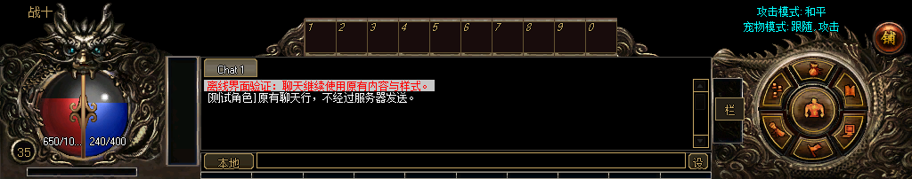

# 聊天框上方快捷栏对齐

2026-11-10：OfficialV1 HUD 隐藏防御、魔防、攻击、魔法、道术、准确和敏捷信息行。快捷栏默认下移 16 像素，直接接聊天框上沿。

- 1024×768：快捷栏从 `(282,570,459,44)` 调整为 `(282,586,459,44)`，聊天框仍为 `(225,630,574,106)`。
- 属性行通过父容器隐藏，属性数据继续更新；界面显隐、重新绑定、分辨率切换均不重新显示。Legacy 还原仍保留原有可见性。
- 读取旧版保存布局时，仅迁移尺寸 459×44、水平居中且 y=屏幕高度−198 的旧默认快捷栏位置，保留自定义位置和显隐设置；读取过程不改写用户配置。
- 保留原有 10 个快捷格及其绑定。聊天历史、输入框和输入草稿继续使用原控件。

## 验证

独立目录编译成功。HUD 842 项、窗口集成 557408 项、完整离线场景 4328 项检查通过。覆盖六种分辨率，27 次真实场景构造，47 帧渲染，9 次 Device.Reset。

截图来自真实客户端离线场景的 `official-hud.png`，裁取底部 1024×202 区域；使用模拟账户和地图，无真实账号登录。

本次验证使用 `E:/workspace/mir3-ui-work/chat-quickbar-20261110/runtime/Zircon.exe`。默认程序仍被运行中的客户端锁定，尚未覆盖；关闭客户端后执行同目录 `Apply-ClientUiUpdate.ps1` 应用已验证程序。

全局布局校验器仍受原有角色绑定文件 SHA256 不一致阻塞；未修改该绑定或其记录摘要。此次对六种分辨率的快捷栏和聊天框相邻关系作了独立检查，并由客户端集成测试验证实际坐标。

更多结果见 [verification.json](verification.json)。
