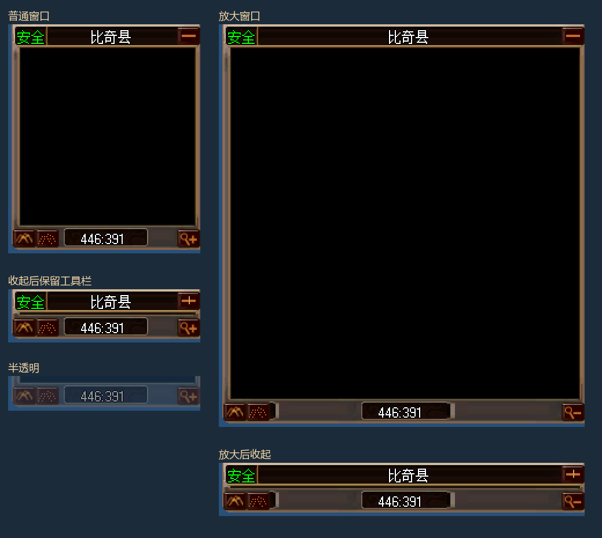

# 小地图底部工具栏验收

日期：2026-11-11。承接标题栏与真正收起，本批补齐新 UI 小地图底栏。

- 左侧山形按钮打开已有大地图窗口，显示当前地图，并置顶、恢复不透明状态；无当前地图或可用大地图窗口时禁用。
- 点阵按钮在不透明和 50% 透明之间切换；提示随外部键盘透明度操作更新。地图、标记、标题和工具栏沿用现有透明度行为。
- 中间显示实时玩家坐标，格式为 `446:391`。坐标槽与文字在普通和放大窗口中均保持原尺寸。
- 右侧放大镜切换普通 166×198 与放大 316×348 视口，按钮在“＋/－”之间切换。扩大可见地图范围，保留原地图像素、标记身份、地图比例与坐标换算。
- 收起后底栏仍可操作；普通收起 166×46，放大收起 316×46。放大保持右边缘，展开和分辨率变化时约束在父容器内。切图和皮肤重绑保留当前状态。
- 工具栏采用正式素材的普通、悬停、按下、禁用四态；仅左键执行操作。素材嵌入客户端，来源与哈希锁定于 `build/game-ui/minimap-button-source.json`。



预览地图区域留空；半透明一栏展示底栏。截图来自离线原生 Direct3D 渲染，不代表已登录游戏验收。放大框通过普通框切片扩展，坐标槽保持原像素；没有向既有 OfficialV1.Zl 包加入另一张大框。

## 验证

完整机器记录见 `verification.json`，最终渲染、运行时和素材包哈希见 `verified-render/`。

1. Client Debug、Release 构建通过。
2. 小地图 CPU/GPU 共 433651 项检查通过。覆盖真实鼠标路由、右键无动作、四种窗口状态、透明度传播、大地图当前地图及重复打开、坐标和底栏 JSON 几何、保留原地图/标记/比例、换图、重绑、异常回滚、卸载与销毁。
3. GPU 验证合成地图裁剪和逐层透明度，206040 个视口像素、195480 个标题外像素、6 帧标题；新增 1850 个像素比较确认放大前后坐标槽及文字保持原尺寸。实际素材悬停变化和三个底栏按钮的透明度均验证通过。
4. 窗口集成 562065 项检查通过，覆盖六种分辨率，新增放大及放大后收起状态在重排、分辨率变化后的保持检查。
5. 共享皮肤 60 项、控件/读取器 26 项检查通过。16 帧按钮素材可重建校验通过；当前 routing 静态校验通过。
6. 全局布局和 joined contract 检查仍被既有转盘规则阻止：`Overlap outside alpha-tested wheel edges: commands.CharacterButton, commands.BeltButton`。在内存中移除全部底栏节点仍复现同样错误，未更新失败的 joined contract，也未改转盘布局。

复现命令：

```powershell
./tests/Run-GameUiMiniMapLayoutTests.ps1 -RenderPath <新的输出目录> -PackagePath E:/workspace/Debug/Client/Data/GameUI/OfficialV1.Zl
./tests/Run-GameUiWindowSetTests.ps1 -PackagePath E:/workspace/Debug/Client/Data/GameUI/OfficialV1.Zl
./tests/Run-GameUiTests.ps1 -Suite Controls
python build/game-ui/Prepare-MiniMapButtonArt.py --source 'E:/Program Files/ShengquGames/Mir3/Data' --check
python build/game-ui/Prepare-CharacterBindings.py --manifest build/game-ui/character-routing.json
```

尚未执行真实地图加载、服务器登录和在线操作验收；放大/收起状态只在当前会话保留。透明度沿用渲染器逐层混合。
