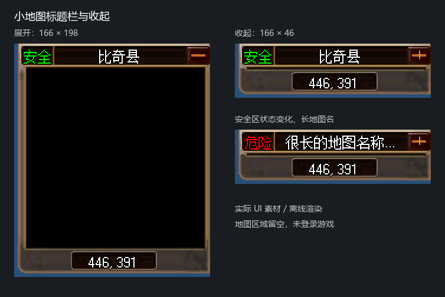

# 小地图标题栏与真正收起验收

日期：2026-11-11。范围为当前新 UI 小地图标题栏与展开/收起。

- 左侧依据玩家 `InSafeZone` 显示绿色“安全”或红色“危险”；缺少玩家或地图时清空。
- 地图名称使用当前 `MapInfo.Description`，独立限定在标题区域，过长时省略，避免覆盖安全状态和右侧按钮。
- 点击右侧 `−` 收起地图视口，窗口保留标题和坐标底栏；点击 `+` 恢复。尺寸由 166×198 变为 166×46。
- 收起状态保留原地图图片与标记控件，坐标和安全状态继续刷新；下方腾出的区域不再接收地图输入。
- 标题/底栏取自原素材，收起时移除中间切片；不把完整背景压缩到小高度。
- 分辨率变化、换图和皮肤重绑保持收起状态；展开时确保窗口不越过父容器底边。
- 卸载新 UI 时恢复原窗口大小、标题样式、视口和关闭按钮行为。收起状态仅在当前会话中保留。



地图区域在这份离线渲染中留空。渲染图用于核对标题、按钮、坐标与素材切片，不代表已登录游戏验收。大地图、透明度工具栏和缩放功能不在本批实现范围。

## 验证

完整结果见 `verification.json`；最终截图和测试运行时/素材 SHA256 见 `verified-render/`。

1. Debug 和 Release 的 Client 构建通过。
2. 小地图 CPU/GPU 回归通过 206273 项检查。包括实际鼠标命中、收起后安全状态/坐标更新、展开/收起、原地图与标记保留、换图、异常回滚和卸载恢复；使用合成地图验证视口剪裁。195480 个标题区域外像素保持一致，6 帧验证长标题和文字边界。
3. 实际素材的窗口集成通过 562035 项检查，覆盖六种分辨率，以及收起时布局重排与分辨率切换。
4. 共享窗口皮肤 60 项、控件/读取器 26 项回归通过。
5. 小地图布局合同补齐安全状态、名称节点，并更新收起操作语义；运行时对应区域与合同逐项比较通过。`character-routing.json` 已按当前代码刷新并通过独立校验。
6. 全量布局及 joined contract 生成仍被既有规则阻止：`Overlap outside alpha-tested wheel edges: commands.CharacterButton, commands.BeltButton`。在内存中移除本次新增小地图节点、恢复此前操作名称后仍复现该错误；未改动右下角按钮布局，也未把失败的生成标记为通过。`character-bindings.json` 保留此前生成结果。

运行命令：

```powershell
./tests/Run-GameUiMiniMapLayoutTests.ps1 -RenderPath <新的输出目录> -PackagePath E:/workspace/Debug/Client/Data/GameUI/OfficialV1.Zl
./tests/Run-GameUiWindowSetTests.ps1 -PackagePath E:/workspace/Debug/Client/Data/GameUI/OfficialV1.Zl
./tests/Run-GameUiTests.ps1 -Suite Controls
python build/game-ui/Prepare-CharacterBindings.py --manifest build/game-ui/character-routing.json
```

尚未执行在线地图切换、真实服务器安全区进出或游戏内截图验收。
