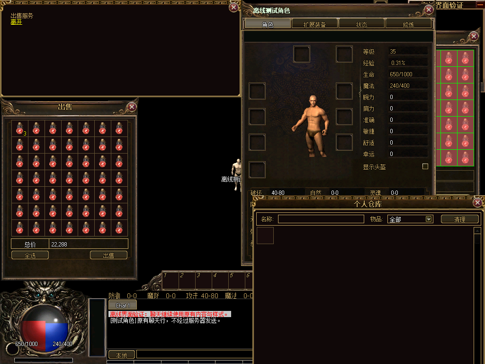
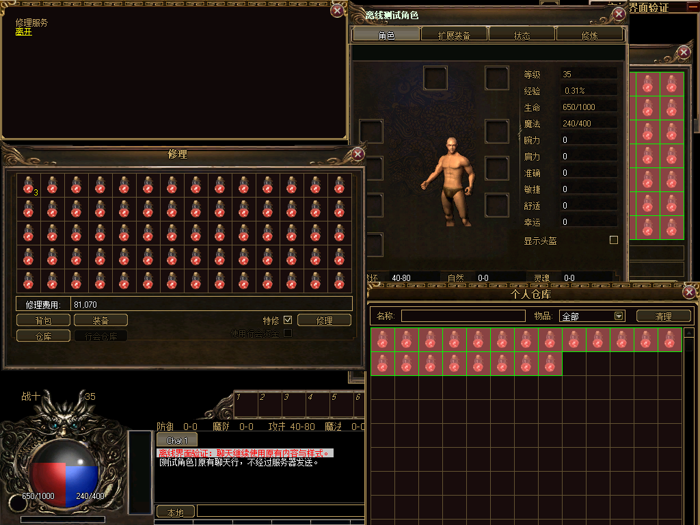

# 出售与修理独立窗口候选接入

以用户确认的1024×768窗口设置为参考。复用已验证的93帧候选包，将独立出售、修理窗口接入商品窗框九宫格；本轮不改素材或正式客户端目录。

| 窗口 | 完整容量 | 原格尺寸 | 候选外框 | 原内容区尺寸 |
| --- | --- | --- | --- | --- |
| 出售 | 7×7，49格 | 36×36 | 294×388 | 246×296 |
| 修理 | 14×5，70格 | 36×36 | 539×338 | 491×246 |

适配器只调整窗框和原内容整体偏移，保留原窗口、格子、按钮、费用标签、事件、业务状态与数据包。窗框复用npc-shop第87帧，固定24px侧边、48px顶部和44px底部，中部伸展；完整物品区和底部操作区不缩放。卸载恢复原尺寸和所有直接子控件位置，保留当前物品链接；遇到SizeChanged订阅者异常可重试恢复。

原NPC主交互卡片的底图、文字、选项、关闭处理均保留；出售数量弹窗继续使用原样式、数量上限和确认处理。游戏显示设置沿用现有方案。未改NPCDialog.cs中的构造器、服务处理或协议。

Debug/Release构建通过；NPC离线场景5328项检查、533次实际坐标点击、42帧实绘、33次Device.Reset与2399935个原卡片像素比较通过。覆盖49格出售、70格修理、背包/仓库/装备来源、堆叠数量与原数量弹窗、费用/特修、观察者限制、逐项发包字段、锁定/清链、关闭清理、卸载重试和场景重入；Legacy、候选样式和再次进入后的有序操作/发包记录一致。原NPC卡片比较范围与既有专项一致。

窗口集成159787项检查、完整场景180项检查通过。完整场景包含3次正常构造、17帧实绘、7次Device.Reset和690512个面板像素比较。NPC及完整场景测试进程的EXE/DLL哈希均与本轮Debug检查清单一致；Release清单也已按实际产物重新生成。93帧Zl包未变，本轮未重复无变化的素材编码或Python素材测试。

第一版测试因合成仓库未设容量而失败，保留[npc-test-v1.log](npc-test-v1.log)。测试随后使用原StorageSize入口初始化仓库，未为测试修改业务代码；第二版和最终版均通过，最终版增加原数量弹窗、装备修理与两个窗口恢复重试的检查。

实绘使用合成角色/物品；前序原生流程留下的角色、包裹或仓库窗口仍可见。图用于核对格子、费用与按钮容纳，窗口组合层次与最终美术仍由UI-25及后续验收处理，不能视为真实游戏画面验收。

[结构化验证记录](verification.json)记录本轮6个源码文件、4个已有文件的哈希转换、命令日志、指标与证据哈希；上一轮报告保持原样。UI-21还缺精炼及领取等窗口与真实服务验收，状态保持未开始；整体7项完成、3项进行中、18项未开始，G0-2/3/4/5未关闭。默认Legacy、RuntimeReady=false、productionBindingAllowed=false。真实登录、服务器、中文IME、最终视觉及整包部署回退仍待验收；本轮未提交或推送。
