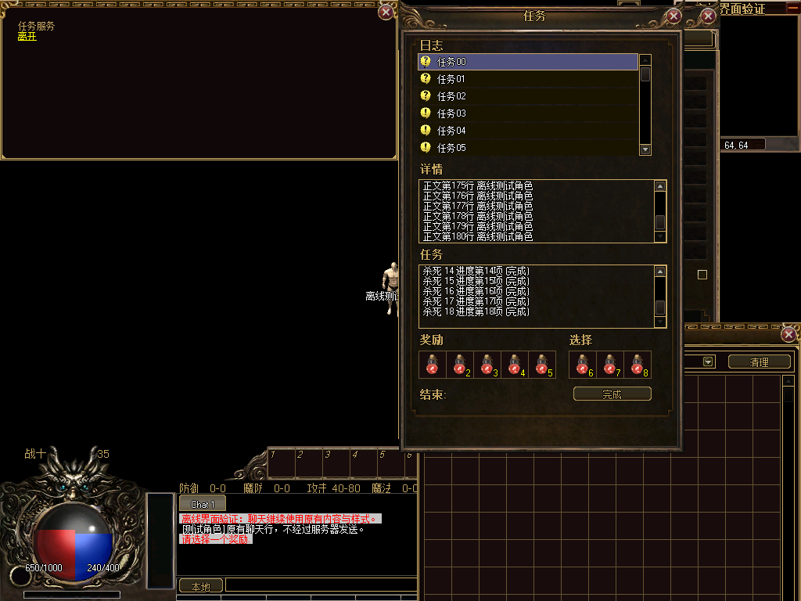

# 任务与奖励独立窗口候选接入

以已确认的1024×768为参考，复用93帧候选包中的npc-shop九宫格窗框。本轮属于UI-22准备性实现，Legacy仍为默认。

- 原六行任务列表、五个固定奖励格、三个可选奖励格及接受/完成事件保留；奖励格仍为36×36。内容宽扩至320px，使八个奖励格及原间隔完整落在窗框内，候选外框368px宽。
- 正文与任务进度分别放入80px高的裁剪区域，保留原DXLabel和原文本。鼠标滚轮、滚动按钮均可使用；按完整换行文本测量高度，覆盖超过2000px的正文。
- 修复原任务行复用问题：滚动及刷新按任务身份重新绑定，清除上一项奖励和高亮，重新计算按钮可见状态。切换到无可选奖励、空列表或清除NPC时不残留旧选择。未选必选奖励仍沿用原提示，不发送完成包。
- 卸载将原文本控件归还原父控件，移除新增监听和裁剪区域，恢复原窗口大小、位置及文字框尺寸；中途SizeChanged观察者抛错后可以重试。原任务类只有接受/完成按钮，没有放弃按钮，本轮不新增放弃操作。

Debug/Release构建通过。NPC专项6713项检查、711次坐标命中、52帧实绘、35次Device.Reset及2399935个原NPC主卡片像素比较通过；Legacy、候选及重入场景的有序操作/发包记录一致。覆盖9个任务的末项、180行正文与18项进度末项、3个奖励的精确提交索引、必选奖励拦截、类别筛选后的零奖励索引、未完成任务、空列表、刷新/重开清理、等待服务器期间不本地添加或完成任务，以及卸载失败重试。既有商品、出售、修理和精炼回归继续通过。

窗口集成159787项、完整场景180项通过。NPC和完整场景测试所用EXE/DLL哈希匹配本轮Debug产物清单，Release产物及全部清单依赖哈希已核对。候选Zl资源未变。

保留早期失败日志：v1测试误用受保护控件集合，v2候选窗口名单断言未更新，v4空列表测试未恢复数据库关联，均已修正；v3为首轮通过，v5为最终边界扩展通过。

该图使用合成角色、物品和任务。前序流程留下的其他窗口仍可见，窗口组合遮挡属于UI-25及最终视觉验收。NPC主交互卡片、二级确认/数量弹窗、游戏显示设置保持原方案。

[结构化记录](verification.json)保存7个源码快照、5个源码哈希转换、命令日志、运行产物核对及证据哈希。历史报告保持原样。G0-2/3/4/5未关闭，UI-22继续保留未开始状态；整体7完成、3进行中、18未开始。真实服务器拒绝/延迟、登录、中文IME、最终视觉、整包部署回退尚未验收。RuntimeReady=false、productionBindingAllowed=false。本轮未提交或推送。
