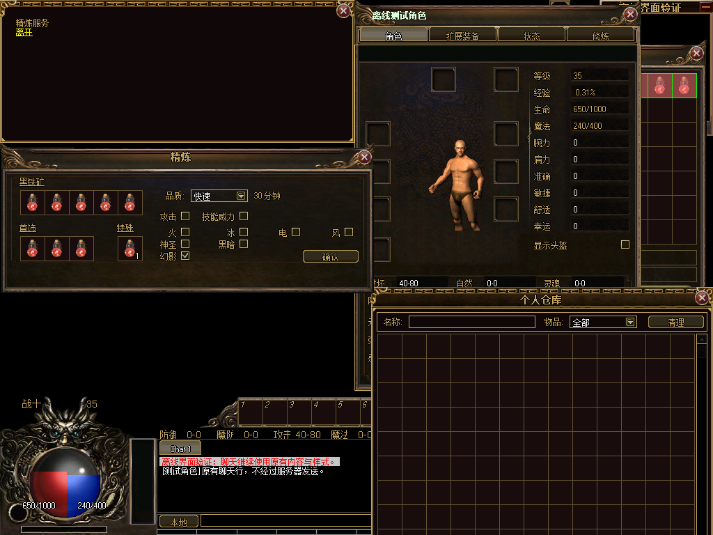
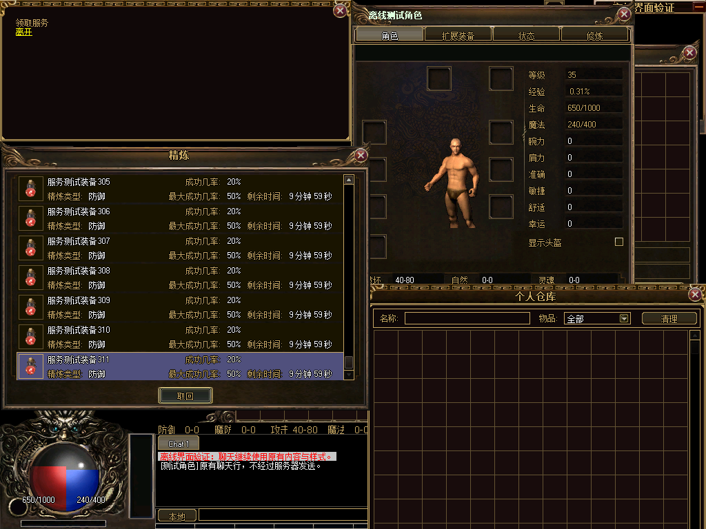

# 精炼及领取独立窗口候选接入

以用户确认的1024×768窗口设置为参考，继续复用93帧候选包中的npc-shop窗框。默认Legacy；本轮属于UI-21准备性候选工作。

- 精炼保留原5个黑铁矿槽、3个首饰槽、1个特殊槽，所有物品格仍为36×36；只平移原内容并应用可伸展窗框。原属性单选、品质选择、耗时显示、材料链接及提交事件继续使用。
- 领取保留原结果格、行距43px、滚动、选中项与领取处理。内容宽491px，按现有规则随结果数显示3～7行，内容高128～299px；候选外框宽539px。原取回按钮放入44px底部区域，滚动条随当前内容区定位。
- 卸载不重建当前结果格，按当前结果数量恢复原生高度、选中项与滚动位置；SizeChanged订阅者中途抛错后可重试。列表正常刷新仍由原方法创建格子并绑定原事件。
- 原精炼服务按NPC卡片右边对齐，新外框会使左侧越界。现只限制独立精炼窗的位置，使全部格子可达。原高级精炼服务借用普通精炼窗宽度计算位置，适配层补偿这项依赖，确保高级精炼的位置和样式仍与Legacy一致。主NPC卡片的代码、样式、文字、选项和关闭逻辑均未改。

Debug/Release构建通过。最终NPC专项6245项检查、650次真实坐标点击、48帧实绘、33次Device.Reset及2399935个原卡片像素比较通过；Legacy、候选和重入场景的有序操作/发包记录一致。覆盖5/3/1材料槽、原九种属性单选、品质和耗时、观察者限制、完整材料请求字段、锁定/清链、关闭，以及0/1/3/7/12条领取结果、首末项与滚动、原结果格身份、选中项、精确领取索引、等待响应期间不本地删除结果和卸载异常重试。出售/修理/商品的既有回归仍通过。

窗口集成159787项、完整场景180项检查通过；NPC与完整场景测试进程的EXE/DLL哈希均匹配本轮Debug清单，Release清单按本轮产物重新生成。Zl未变，未重复无变化的素材编码及Python素材测试。

保留初期失败记录：[测试接口签名修正](npc-test-v1.log)、[精炼左侧越界](npc-test-v2.log)、[高级精炼位置依赖](npc-test-v3.log)。最终结果见[npc-test.log](npc-test.log)，没有将失败记录计入通过命令。

实绘为合成角色和物品，前序原生流程留下的其他窗口仍可见。窗口组合与遮挡属于UI-25及后续验收，本轮不能替代最终画面或真实服务验收。二级数量/确认弹窗及游戏显示设置沿用原方案。

[结构化验证记录](verification.json)包含7个源码快照、5个源码哈希转换、命令日志和证据哈希，历史报告保持原样。UI-21五个窗口已有候选接入，但服务器拒绝/延迟、全量异常边界及正式视觉验收未完成，任务状态继续未开始；整体7完成、3进行中、18未开始，G0-2/3/4/5未关闭。RuntimeReady=false、productionBindingAllowed=false；真实登录、服务器、中文IME、最终视觉和整包部署回退仍待验收。本轮未提交或推送。
