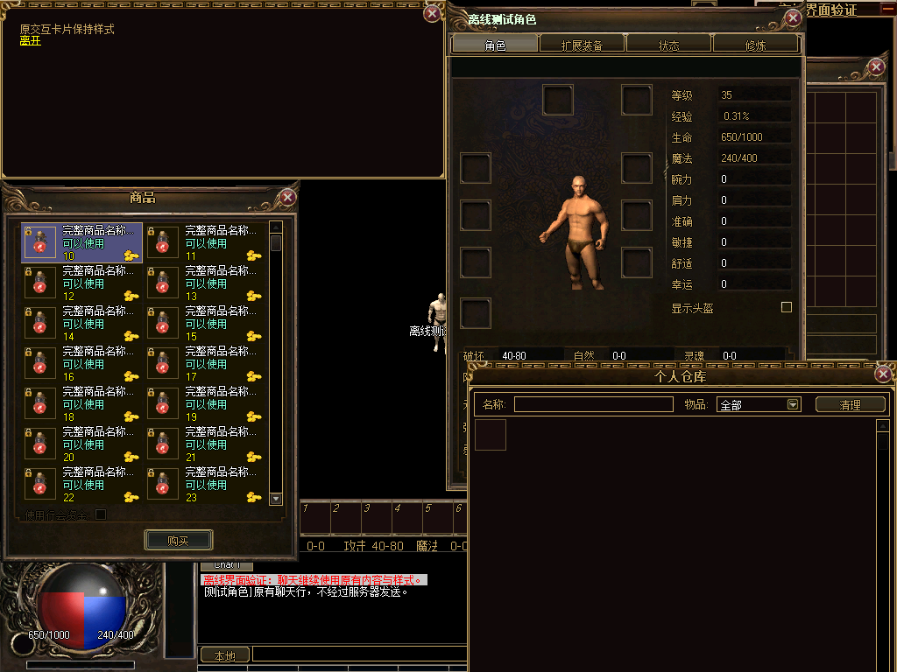

# 独立商品商店七行视口修正

以用户确认的1024×768窗口设置为参考。原接入使用54px行距，在324px内容区只能完整显示6行；本轮恢复UI-21要求的7行，两列共14个商品同时完整可见。

- 外框344×438、内容区(24,48,280,324)和原36×36物品格保持不变。行距46px、顶部留白2px、单格138×45；第8行从内容区底边开始，不显示半格。
- 名称、需求、价格各占15px，继续使用原字体和颜色；完整名称、需求和价格提示绑定到实际接收鼠标事件的原商品行，文字变更即时更新，卸载后恢复原提示；货币图标按实际尺寸在格内右下对齐。滚动范围包含顶部留白，末行完整可达。
- 复用原商品、选择、购买及数量弹窗；未改NPC交互卡片、网络协议或购买处理。

实测结果：Debug/Release构建通过；NPC离线场景2427项检查、128次实际坐标命中、36帧实绘、27次Device.Reset及2399935个原卡片像素比较通过；三个场景的有序操作/发包记录与数量弹窗几何一致。新增断言确认7行完整显示、第8行完全裁剪、第7行末商品可选、原字体不纵向裁切、物品/文字/货币图标均在格内，实际文字位置悬停可取得完整提示，长数字价格更新不影响购买数据。窗口集成159787项检查通过，含卸载和异常恢复。

93帧Zl包未变化；新Debug/Release检查清单与本轮程序匹配，测试进程使用的EXE哈希与Debug清单一致。本轮只调整商品几何并运行相关回归，未重复无变化的素材编码或Python测试；之前结果见[独立商品商店接入](../npc-shop-binding/README.md)。

[结构化验证记录](verification.json)包含源码哈希转换、命令日志、指标及证据哈希。上一轮报告保持原样。UI-21尚未完成全部窗口及真实服务验收；其状态保持未开始。整体7项完成、3项进行中、18项未开始，G0-2/3/4/5未关闭。默认Legacy、RuntimeReady=false、productionBindingAllowed=false；真实登录、服务器、中文IME、最终视觉及整包部署回退仍待验收。本轮未提交或推送。
