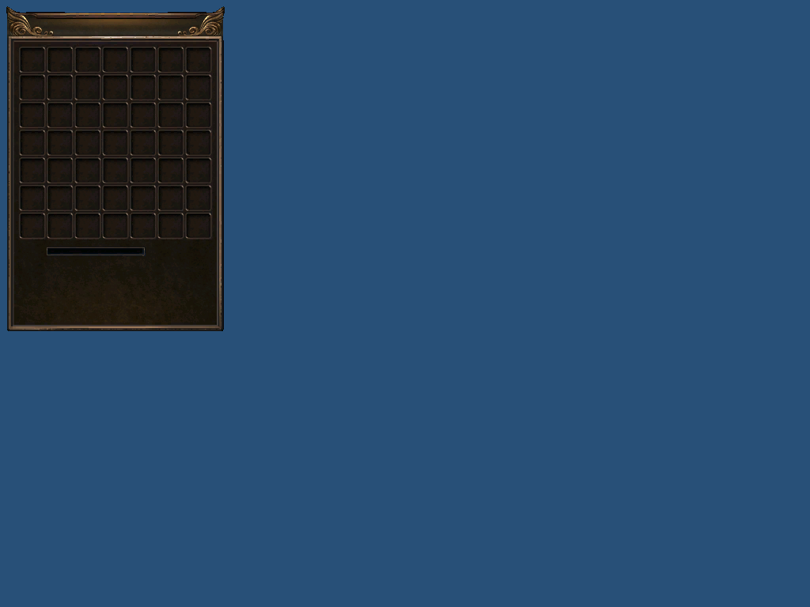
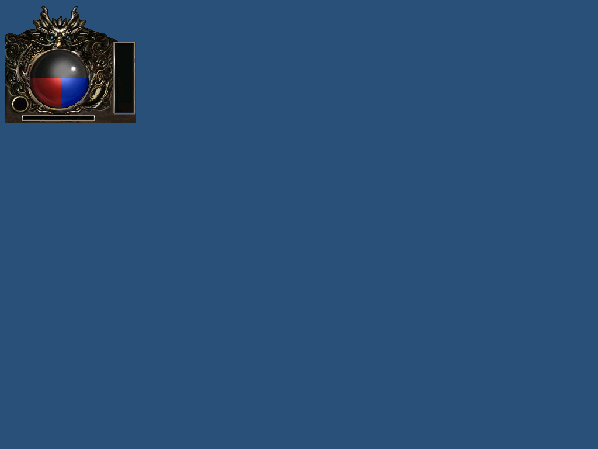
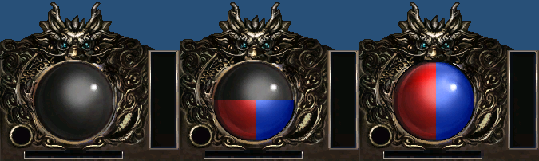

# 真实素材拼接与 Zl 实绘核对

本次产物是接入测试包，未绑定 GameScene，也未通过完整游戏验收。源正式版安装目录保持只读；继续沿用用户确认的 1024×768 基准，不需要重复截图。

| 项目 | 已核对结果 |
| --- | --- |
| 素材 | 27 张选图生成 84 帧，19 组显式按钮四态 |
| 包裹 | 276×412，7×7 共 49 格；单格 36×36、步长 35；保留原尺寸页头和页尾 |
| 快捷栏 | 459×44，共 10 格；保留原尺寸两端装饰 |
| 透明 | 只清除与外边相连的纯黑区域；封闭黑色内框保留；小地图另设纯黑透明显示区域 |
| 偏移 | 输出 offset/pivot 均为零；血球分层用原偏移之差定位，仅应用一次 |
| 按钮 | normal 原图；hover 115%、pressed 75%、disabled 灰度 60%；四态透明掩码一致 |
| Zl 检查 | 553,617 个逻辑像素的透明度一致；9,983 个补齐像素透明；3,178 个黑色内框像素保持不透明 |
| 客户端实绘 | 84 帧及血球 0/50/100% 共 87 张，比较 689,967 像素，透明区域背景严格一致 |
| RGB 压缩 | 硬件渲染与独立 BC1 解码的最大通道差 5；测试容差 8；不宣称颜色无损 |
| 确定性 | 两次拼接的全部文件及两次打包的全部文件逐文件一致 |
| 回归 | 拼接 22 项、打包 16 项、原解码 18 项及原资源 70 项检查通过 |

测试包位置为 `E:/workspace/mir3-ui-work/composed-zl-20261107-verified2-v1/OfficialV1.Zl`。来源、输出哈希及实际命令日志见 [验证记录](verification.json)。`runtimeReady=false`、`productionBindingAllowed=false`、`alphaVerified=false`，禁止将该准备包直接当成交付包。

## 实绘对照

以下是客户端 D3D9 渲染器的离屏测试结果，不是正式版游戏运行截图。

## 后续接入

继续完成聊天外框、功能按钮容器等剩余组合，冻结完整语义目录及六种分辨率布局，然后生成编译目录、接入 GameScene、角色与包裹主窗口。聊天列表保留现有字体、颜色、频道及历史；NPC 卡片、二级弹窗和显示设置保持当前范围决定。

本记录不关闭 G0，也不将 UI-05、UI-07 或全游戏用例标为完成。完整交互与重启回退仍需后续验证。
