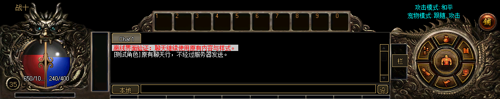

# 正式快捷栏对齐（2026-11-10）

原快捷栏把 UI[430] 从 518×44 改造成了 459×44，并叠加原生网格的不透明底色、35 像素格距和方形边框，遮住圆角槽位。修复恢复正式贴图原尺寸、十个 41×40 槽位和正常橙色数字标签；关闭原生网格底色/边框绘制，原物品单元、关联和回调保持原对象。关闭 OfficialV1 后恢复旧版尺寸、边框和标签样式。

默认位置居中且下沿紧贴聊天框。读取旧 459 像素宽布局时更新宽度，只迁移两个已知默认位置（旧角色属性行存在/隐藏），保留自定义坐标和可见性，读取过程不写配置。



验证：快捷栏适配 7181 项、HUD 842 项、窗口集成 557498 项、完整场景 4328 项。后者包含六种分辨率、场景重入和设备重置。额外以独立 BC1 解码逐像素检查左右端饰与最后一格的右边/底边：8 张实际截图共 32 组通过，RGB 容差 8，详见 render-verification.json。未连接真实账号。

资源包只有第 3 帧 quickbar-base 改变，其余 93 帧尺寸、偏移和 BC1 数据逐帧相同。构建输入和最终包在 E:/workspace/mir3-ui-work/quickbar-native-20261110。先按 warehouse-combined-composition-recipe.json 生成正式快捷栏，再将该帧和网格描述覆盖到原有固定 art 快照，使用 ImageManager --official-ui prepared 打包，并用 Compile-UiCatalog.py 编译/验证目录。保留原背景是因为当前完整 recipe 重生成还会改变已有角色背景，此项不属于本轮范围。prepared-manifest.json 保存最终打包描述；source-libraries 使用原 decoded/baseline.json（902153e4...），而非另一版本的默认 source-libraries.json。

全量布局 CLI 仍在此前角色绑定文件 SHA256 检查处失败；没有修改该绑定或放宽校验。

复验裁切：

```powershell
python build/game-ui/Verify-QuickbarRender.py --package E:/workspace/mir3-ui-work/quickbar-native-20261110/zl-preserved/OfficialV1.Zl --evidence E:/workspace/mir3-ui-work/quickbar-native-20261110/fullscene-02 --output E:/workspace/mir3-ui-work/quickbar-native-20261110/render-verification-repeat.json
```

默认启动目录 E:/workspace/Debug/Client 的 Zircon.exe、Zircon.pdb 和 Data/GameUI/OfficialV1.Zl 已更新，并核对程序与资源包 SHA256。原文件备份于 E:/workspace/mir3-ui-work/quickbar-native-20261110/default-backup-20261110-142416。启动配置保持原值，继续使用已有 OfficialV1 调试入口；发布检查清单生成成功，但 RuntimeReady=False，尚未解除正式发布门禁。
