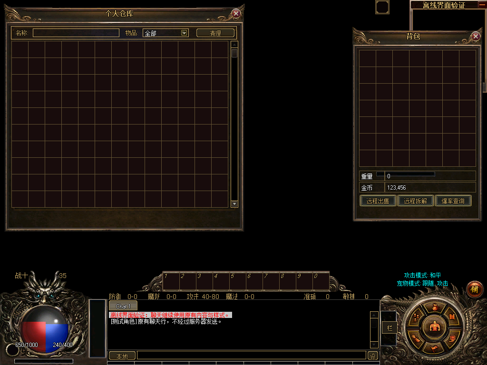

# 仓库可恢复布局与隔离场景验证

日期：2026-11-08。参考为用户确认的1024×768窗口模式，复用已有截图，无新增采图要求。承接[仓库底板候选](../warehouse-candidate/README.md)；本轮完成原仓库布局适配接口及隔离D3D9场景测试，尚未由正式换肤入口安装。

## 实施内容

- 新增GameUiStorageLayout及StorageDialog.UseGameUiStorage。只移动原筛选容器、原网格和原滚动条；保留全部原控件、36×36格、容量规则、筛选、滚动、存取处理及事件。
- 原13列网格显示10行，容量继续由原业务决定；适配接受构造阶段1×1占位格及后续RefreshStorage产生的动态网格，不在换肤时重建格子。
- 首次安装保存原坐标，切换候选保留初始快照；卸载恢复原坐标。观察者抛错时回滚，拒绝重入、替换控件、错误父级和越界布局；销毁清除绑定。
- 筛选子控件实测范围均在473×26容器内：名称标签(5,5,36,15)、输入(46,5,180,16)、物品标签(236,5,36,15)、下拉(277,5,95,16)、清理按钮(389,4,80,18)。未缩小原字体或控件。

## 候选几何

以下均为窗口局部坐标；候选窗口508×480，尚未冻结。

| 区域 | x,y,w,h |
| --- | --- |
| 标题 | 24,10,440,18 |
| 拖动 | 8,0,460,38 |
| 关闭 | 478,10,18,18 |
| 筛选 | 16,48,473,26 |
| 网格 | 16,78,456,351 |
| 滚动条 | 478,79,14,349 |

隔离场景将仓库置于(8,8)，包裹沿用现有候选布局，二者均在1024×768内且不相交。该固定测试位置不能代替NPC响应分支、拖动、重开及六分辨率组合布局的正式实现。

## 验证结果

| 验证 | 结果与范围 |
| --- | --- |
| Debug / Release | 均构建通过，分别生成匹配检查清单 |
| 原仓库控件专项 | 35,276项通过；容量0/27/131/1000、动态刷新、身份/事件、原筛选/清理/滚动、失败回滚、重入及销毁 |
| 隔离D3D9场景 | 62项、4次完整呈现、1次设备重置通过；仓库243,840像素完全一致；实际坐标命中原格13及130、131格禁用边界、筛选/清理及关闭联动 |
| 原NPC卡片回归 | 6,621项、707次坐标命中、48次呈现、33次重置；2,399,935原卡片像素一致 |
| 窗口集成回归 | 159,787项通过，含六分辨率、身份/聊天保持、启动/重进和回滚 |

像素重置比较隐藏合成场景的地图层，排除透明边缘后方角色动画；仓库、包裹和HUD仍由真实控件绘制。没有连接服务器，没有发出真实存取请求。完整日志、文件哈希和失败尝试见[verification.json](verification.json)。

[重置后](warehouse-after-reset.png) · [滚动末格](warehouse-scrolled.png) · [原名称筛选](warehouse-filtered.png)

## 失败尝试与修正

- 首次控件测试直接调用无MirDB会话的ItemInfo属性设置器失败；测试夹具改用字段准备合成数据。
- 三次动态测试卡在未初始化的替代DXItemGrid。按原生顺序先创建1×1格，再设置类型/尺寸，后续通过。没有改动原网格生命周期实现；过程日志保留。
- 首次渲染重置比较在透明右边缘(514,344)发现差异，背后角色正在动画；[失败图](failed-scene/warehouse-before-reset.png)与日志保留。最终测试隐藏地图层后全仓库像素一致，此调整仅在测试夹具内。

## 交付边界与后续

当前底板明确复用商店UI[511]；没有认定其为正式版仓库原图。关闭按钮仍绘制原生图。1帧仓库包不能直接替代现有93帧包；包与目录未变，GameUiOfficialV1WindowSet未安装仓库皮肤，素材用途校验继续报告仓库缺项。

下一步合并仓库候选、更新目录与用途合同，再实现仓库安装/卸载及组合定位，覆盖实际存取请求和重开/切场景流程，最后进行视觉、输入法和真实游戏验收。

Legacy仍为默认，RuntimeReady=false，productionBindingAllowed=false，layoutFrozen=false，releaseAccepted=false。NPC交互卡片与二级弹窗保持原样式，显示设置页面不换肤。UI-05继续进行中；UI-25依赖和输入门槛仍未满足，保留未开始。四项未关闭门槛不变；本报告不构成零缺陷保证或发布验收。
