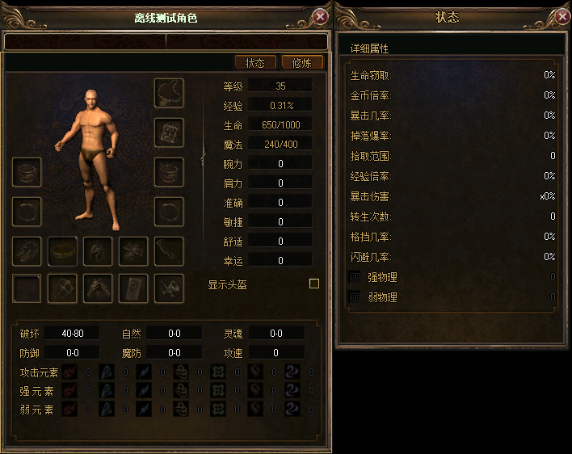
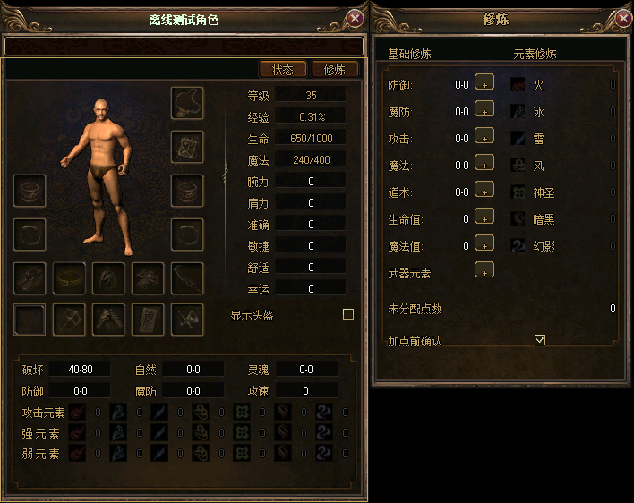
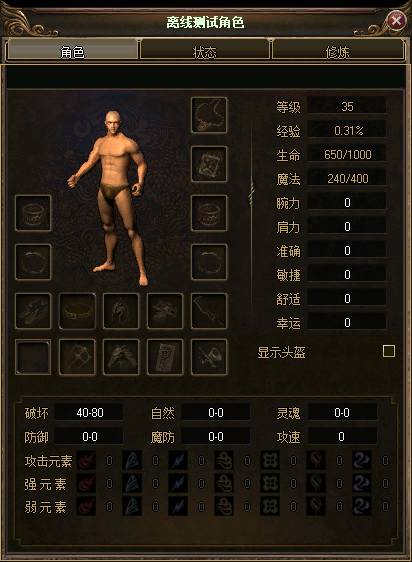
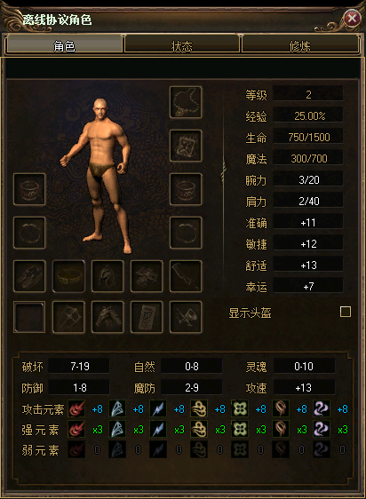
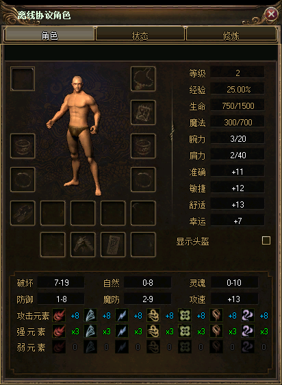

# 角色面板素材复核（2026-11-10）

确认以 **UI[2765]，412×562，偏移 (0,0)** 作为当前新 UI 角色面板的素材基准。此前推荐 UI[100] 偏重旧官网示意图，应撤回该推荐。

- UI[100]：366×484，旧版标准布局，装备区及底部区域均不同。
- UI[1720]：412×503，右侧另带一列金色装备槽。
- UI[2765]：412×562，与当前窗口尺寸一致，包含双排底部装备槽与较高的下方属性区。

## 现有差异来源

reference-selection.json 已选择 UI[2765]。composition-recipe.json 的 character 角色将 (8,90,396,461) 内区用纹理覆盖；character-main-background 再执行旧槽位修补、属性框重排并裁切成 412×498 的主页背景。运行时另叠加 36×36 装备格及独立布局。因此原始素材与现有面板之间的差异，需要检查加工配方和控件布局。

[对照图](confirmed-2765-comparison.png) 的前三列是原始素材，第四列为现有合成底板与主页背景叠加，不包含运行时人物、装备格和文字控件；不是游戏截图。第四列取自既有 character-art-20261108-v1/art-final 导出物。

本次重新只读扫描本地官方 Data 目录四个库，共 8934 个索引位、2308 个非空条目；按零偏移及面板尺寸筛选后成功解码 138 张。UI[5107]、UI[5322] 的严格解码失败保存在 inventory.json，未用作候选。当前 UI 库的整体哈希已不同于旧固定基线，但 UI[100]、UI[2765] 的导出像素分别与此前参考逐像素一致。

以上为素材复核阶段的结论，当时未修改客户端与运行资源；后续实现见下文。confirmed-selection.json 保存复核结论；survey.py 可重新执行只读扫描并生成候选图。

## 最新方案：状态／修炼右侧外挂卡片（2026-11-11）

本节覆盖下文历史记录中的“三页签／卡片内切换”方案。角色名居中、全部装备槽、人物位置和主页属性布局均保持不变。

- **承载底板：UI[130]，296×436**。同系列金棕边框、原生标题和关闭按钮，保留底板纹理，不新画通用网页卡片。
- **入口按钮：UI[3304]，原图 57×24，经九宫格适配为 56×22**，位于角色卡片 (288,66)／(346,66)，显示“状态／修炼”，匹配参考图“炼体／称号”的小金框样式，具备正常、悬停、按下、禁用四态。
- 两个入口不再切换角色卡内部内容。点击后在角色右侧紧贴、顶部对齐；再次点击收起，切换另一入口仅替换外挂内容。拖动角色跟随，临近屏幕右边缘时整体左移避让；关闭外挂不关闭角色，隐藏角色同步隐藏外挂。
- 状态采用 12 行左标签／右数值；修炼分为基础修炼、元素修炼两列，底部放未分配点数和加点确认。复用原有实时数值、图标、加点按钮、确认框和事件处理，不复制假数据，不改协议。
- 修炼容器采用非排序、空白穿透，防止点击加点／确认后将内容层提到关闭按钮上方。

坐标见 [companion-layout.json](companion-layout.json)，实际源库哈希见 [companion-source.json](companion-source.json)。新包保留旧 94 帧，仅追加底板及按钮四态共 5 帧，合计 99 帧／20 个按钮组。旧源库基线与当前本地库整体哈希不同，因此当前抽取证据独立记录，不覆盖旧基线。

完整离线渲染通过 5,929 项检查，涵盖真实鼠标命中、确认框切换、关闭、吸附跟随、六种分辨率、场景重入和实时属性刷新；Debug / Release 构建与现有专项回归详见 [companion-verification.json](companion-verification.json)。这是本地真实 Direct3D 渲染和合成账号／地图验证，不是正式账号登录或用户最终视觉验收，生产门禁仍为 false，未重启服务器。

## 角色名标题居中（2026-11-11）

角色名由左对齐改为水平／垂直居中，标题区域为 (42,10,328,22)，中线与 412 像素面板的 x=206 一致。右侧婚姻图标、关闭按钮位置不变，保留长名称省略和完整名称悬浮提示；旧版布局回滚后仍恢复原样。其余装备、人物和属性布局未调整。

Debug / Release 已重新构建。控件检查 4,009 项、完整离线渲染检查 4,386 项、六种分辨率与布局契约检查通过，记录见 [name-centering-verification.json](name-centering-verification.json)。

## 当前方案：勋章与照明装备共用（2026-11-10）

当前实现以本节为准，下方各节保留前面批次的调整记录。

采用 UI[2765] 原生底板，36×36 物品控件对齐 38×38 原生边框。角色主页保留所有装备。此处原三页签方案已由上方“状态／修炼右侧外挂卡片”方案替代。左上角不添加装备槽；左下角新增独立毒药格。

| 区域 | 按从上到下或从左到右排列 |
| --- | --- |
| 左侧 | 护腕、戒指 |
| 右侧 | 项链、勋章／蜡烛／火把共用格、手镯、戒指 |
| 下方第一行 | 鞋子、腰带（暂未开放）、头盔、衣服、武器 |
| 下方第二行 | 毒药、盾牌、马牌、护符、功能道具 |

勋章与蜡烛、火把占用同一个真实装备槽（Emblem，索引 14），同时只能装备一件；自动穿戴、直接替换、重量校验与服务端均采用该规则。照明装备仍按 ItemType.Torch 处理，按原间隔消耗耐久；勋章不消耗照明耐久。毒药和护符分别独立，功能道具继续使用原 Flower 槽。当前协议没有腰带装备类型，因此仅保留素材上的腰带框并提示“腰带（暂未开放）”，不伪造腰带功能。

原 Torch 索引 3 保留枚举、协议与存档编号，但禁止新装备并隐藏控件。角色加载时自动处理旧照明装备：共用格空闲则迁入；已有勋章则原照明装备退回首个空背包格；背包满则通过系统邮件返还。同一物品对象继续保留，重复加载不重复返还。

主页背景直接裁取原始素材 (0,64,412,498)，去除之前为错误槽位制作的六处内区修补。205,176 个像素及透明轮廓与原生裁片完全一致；其余 93 帧素材和包内帧数据保持一致，见 [原生素材核验](shared-slot-native-verification.json)。核验使用既有基线 PNG；本目录 raw PNG 的压缩字节不同，但 RGBA 像素一致，双方哈希保存在 [本轮核验记录](shared-slot-verification.json)。

Debug、Release 客户端构建通过，两个运行目录的 Data/GameUI/OfficialV1.Zl 已同步。客户端实际控件、装备交互和完整离线渲染检查通过，覆盖 15 个有效装备格、六种分辨率、三个页签和设备重置。服务端隔离构建与 94 项回归检查通过，覆盖真实 ItemMove、重量和属性替换、照明耗尽、旧槽拒绝以及空／满背包下的四组迁移和重复加载。服务端测试通过临时 MirDB 对象与无 socket 队列执行，未连接实际账号数据。

当前运行的 Server 进程未重启，新的服务端穿戴规则需在更新并重启服务端后生效；已构建服务端保存在 E:/workspace/mir3-ui-work/character-shared-slot-20261110/server/。运行资源与备份位置见 [runtime-staging.json](runtime-staging.json)。所有验证为离线或隔离验证，未标记真实登录验收通过。

## 历史批次：初次落地的 2765 布局（2026-11-10）

按确认方案恢复 UI[2765] 的原生龙纹、装备格边框与属性底框。**16 个装备槽全部放在角色主页，只保留「角色 / 状态 / 修炼」三个页签，没有扩展装备独立页。**

图中为真实客户端控件与 Direct3D 渲染，使用离线合成角色和场景，包含原刷新链路生成的数值。不是素材拼接示意，也不代表真实服务器登录验收。

主页装备位沿用 2765 的 15 个原生槽框，并为武器补一个 36×36 槽框。六处不匹配的空槽图案仅修补各自 30×30 内区，保留框线；头盔、项链、手镯、戒指、鞋子、衣服及护身符等原有图案按实际槽位对应。原 Grid[0..15] 的物品数据、点击及穿脱处理继续复用。人物预览、等级/经验/生命/魔法和属性控件按原生底框对齐，状态与修炼沿用各自页面。

`character-main-background` 使用原始素材的 (0,64,412,498) 裁片，不再对主页大面积覆盖纹理。共享的 `character` 清理底板仍供状态/修炼页使用。重新合成后，只替换当前 94 帧素材集中的角色主页层，保留此前已调整的快捷栏、轮盘、血蓝球等其余 93 帧。

[像素与资源核验](native-verification.json) 确认六处修补范围外 199,776 个像素与 UI[2765] 原图的对应区域逐像素一致，透明轮廓一致；其余 93 张 PNG、素材描述和 Zl 打包后的帧数据均与上一版一致。独立检查入口为 `tests/game-ui/Verify-NativeCharacter.py`，参数为 `--source`、`--art`、`--package`、`--previous-art`、`--previous-package`、`--output`，分别指定原始 PNG、本批与上批导出物、输出报告。此前 `Verify-CharacterSurfaces.py` 对应封存的纹理覆盖批次，不再用于判定本批原生面板。

## 构建与交互核验

Debug、Release 客户端构建通过。角色分页、属性、控件、人物合成、资源目录、布局契约、完整离线场景和物品交互检查全部通过。布局契约明确断言三个页签及 16 个槽均归属角色主页；验证器同时拒绝 18 种无效布局，11 份生成文件重复运行逐字节一致。

完整场景覆盖六种分辨率、三个页签、场景重入与 9 次显式 Device.Reset；物品检查覆盖全部 16 个槽位穿脱、2,076 次坐标命中及 Legacy/Official/重入后的事件轨迹一致性。构建日志摘要与哈希保存在 [implementation-verification.json](implementation-verification.json)。这些结果属于离线和模拟账号验证；真实登录、服务器行为、硬件设备丢失及中文 IME 仍需实际运行验收。

已将本批 `OfficialV1.Zl` 同步至 `E:/workspace/Debug/Client/Data/GameUI/` 和 `E:/workspace/Release/Client/Data/GameUI/`，与编译目录一致。两个客户端可通过各自 `Start-OfficialUiPreview.cmd` 启动新 UI 预览；旧资源已在工作目录备份，文件哈希与备份位置见 [runtime-staging.json](runtime-staging.json)。资源包 SHA256 为 `639a5b6762f22dfc6cd837d2765ff0a558068ffa5c89f1b58194f66003baba5d`。正式发布门禁仍保持原状态。

## 人物腿脚裁切修正（2026-11-10）

人物绘制基点原为 (124,280)，而男女基础图像的脚部实际分别延伸到基点下方 55、60 像素，超出了预览区域底边 288。现将基点改为 **(124,220)，整体上移 60 像素**，保留原图大小与 16 个装备槽布局。基础男女图像均完整落在预览区域内，脚底分别留出 13、8 像素空间；该批次的截图保存在 character-preview-raised-runtime.png；上方展示图为下文继续对齐后的最新结果。

Debug / Release 重新构建通过，人物合成检查 1,923 项、完整离线场景检查 4,386 项通过，覆盖六种分辨率、切页、重入及设备重置。两个本地客户端已使用新构建。图像偏移与完整性核对见 [body-fit-verification.json](body-fit-verification.json)，最新构建、运行文件及截图记录见 [preview-position-verification.json](preview-position-verification.json)。

## 按参考图继续对齐（2026-11-10）

此前人物只上移，仍向右偏约 36 像素，头部也高于用户参考图。现根据 ProgUse 原始图像偏移，将绘制基点从 (124,220) 调为 **(88,234)**，即向左 36、向下回调 14 像素；相对最初 (124,280) 仍整体上移 46 像素。头部落在参考图约 x=113、y=112 的位置。预览区域同步改为 (54,96,134,198)，底边精确接到下方装备槽的 y=294 上沿。男性基础图像完整范围为 (66,111,84,178)，女性为 (66,112,80,182)，两者均完整显示，且预览区与 16 个装备槽均无重叠。

16 个装备槽、三个页签、2765 原生底图保持此前方案。Debug / Release 重新构建通过，人物合成检查 1,923 项、完整离线场景检查 4,386 项通过。上方截图已更新为最终构建的实际离线渲染；最新几何、原图偏移、日志和运行文件哈希见 [alignment-verification.json](alignment-verification.json)。

## 装备槽、属性与文字完整显示修正（2026-11-10）

本节与上方最新截图记录本轮最终坐标；前面的截图和核验文件保留为历史批次。装备槽已按原生 38×38 外框校正，36×36 物品控件位于框内 1 像素处，上方槽位的纵向步长为 49 像素。人物预览最终区域为 (54,96,134,197)，绘制基点为 (88,233)，男女基础角色的腿脚均完整显示。16 个装备槽继续位于角色主页。

按用户提供的正式版截图对齐右侧及下方属性。右侧名称 x=276，数值 x=306；下方三列名称 x=24/150/276，数值 x=54/180/306，数值在各自底框内居中。下方第二行最右侧恢复为“攻速”。“攻击元素 / 强 元 素 / 弱 元 素”的行起点为 y=450/473/496；元素图标保留完整 20×20 原图，第一列 x=76，列距 46 像素。

名称栏收窄后，TextRenderer 默认左右留白曾使“等级”“攻击元素”等文字触发省略号。本次调整名称栏边界，并为角色主页名称设置 NoPadding，保留原字号。最新客户端实际渲染已确认这些文字完整显示。

Debug / Release 构建通过，属性、控件、人物合成、即时数值和分页检查全部通过，布局契约和 11 份生成文件一致性检查通过。完整离线场景 4,386 项检查通过，覆盖 47 帧实际呈现、六种分辨率、三个页签及 9 次显式设备重置。测试所加载 Debug 程序的哈希与当前构建一致；仍属离线合成账号和场景验证。

最终坐标、截图、构建与检查日志哈希见 [property-alignment-verification.json](property-alignment-verification.json)，原生装备槽的像素边界核验见 [equipment-pixel-alignment.json](equipment-pixel-alignment.json)。[正式版参考截图](official-property-reference.png)与[当前实际渲染](character-properties-aligned-runtime.png)一并保存。
