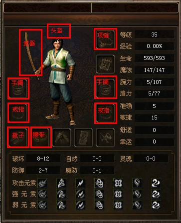

# 登录后游戏 UI 正式版风格适配实施方案

版本：设计 v1；核对日期：2026-11-07。目标仓库：`E:\workspace\mir3-zircon-server`。素材基线：`E:\Program Files\ShengquGames\Mir3`，本机 `Mir3.exe` 的 FileVersion 为 `1.9.3.137`，不代表官网当前最新版本。

**结论：可以实施，但必须同时改布局、绘制与控件绑定，不能只覆盖图片。保留现有玩法、数据与发包路径，以正式版素材重建登录后的页面。本文只交付设计，未实现、构建或完成游戏内验收。**

“0 bug”转化为交付门槛：本方案范围内已知缺陷为零、所有必测项通过、证据完整；无法事先保证绝对不存在未知缺陷。下文未核实项必须先关闭，不能用猜测填充后宣称完成。

## 1. 范围与固定决策

| 项目 | 实施决策 |
| --- | --- |
| 登录后的常驻界面 | 更换底部 HP/MP、经验、快捷栏、聊天、功能按钮、小地图外框；保留地图内容与坐标逻辑 |
| 角色面板 | 重建人物预览、装备布局、属性区域和标签页；全部 16 个装备槽继续可用 |
| 包裹 | 固定 7×7，共 49 格；正式版 6×8 底图重新拼接，采用单页，不引入分页 |
| 快捷栏 | 保留 10 个链接及现有键位语义；底板按真实格宽拼接，不按图片宽度推断容量 |
| NPC | 覆盖本文列出的 17 个窗口及其辅助行、物品格、数量/确认弹框和关联仓库 |
| 装备提示 | 更换物品悬浮卡片的边框、字体、间距、颜色层级；字段来源和使用条件沿用当前实现 |
| 其他界面 | 登录、选区、选角、启动器不改；技能、交易、行会等其他窗口仅保留入口，不扩展为全 UI 改造 |
| 服务端与协议 | 不改 `EquipmentSlot`、`ItemType`、容量常量、服务器计算规则、网络包和持久化数据结构 |
| 切换方式 | 增加客户端启动配置 `GameUiStyle=Legacy/OfficialV1`，重启生效；开发包默认 Legacy，验收通过的交付包默认 OfficialV1 |

正式版独有的槽位或功能，如果当前项目没有对应能力，不创建看似可用的按钮或假数据。本文适配的是视觉和操作布局；要求新增腰带系统等玩法时，另立数据与协议变更。

## 2. 官网资料如何使用

官网原页：[装备介绍](https://mir3.web.sdo.com/web7/news_con.html?id=297843)。已读取页面实际调用的官方正文接口，并查看两张配图；发布时间是 **2018-09-07 16:15:01**。证据保存在 [资料目录](assets/official-ingame-ui/README.md)。

| 官网信息 | 能解决的问题 | 使用边界 |
| --- | --- | --- |
| 带部位标注的角色面板图 | 确认武器位于人物左侧、项链位于右上、双手镯与双戒指分列两侧、鞋子位于左下，以及人物/右栏属性/下方元素的分区 | 图为历史截图，尺寸 363×446；本地 `UI[100]` 为 366×484，不能按同一比例直接套坐标 |
| 右栏等级、经验、生命、魔法、腕力、肩力、准确、敏捷、舒适、幸运 | 确定主面板的优先信息及其顺序 | 腕力对应当前手持负重，肩力对应穿着负重；数值取当前角色数据 |
| 下方破坏、自然、灵魂、防御、魔防，及攻击/强/弱元素 | 确定基础属性和七系元素的展示形式 | 使用当前 `Stat` 与格式化逻辑，不从截图抄固定数值，不改元素计算 |
| 装备提示图中的持久、重量、属性、条件等 | 确定悬浮卡片的文字层级与配色参考 | 只显示当前数据实际支持的字段；没有来源的“武器等级”等字段不补 0 |
| 正文的装备分类与元素描述 | 补充名称、概念的核对依据 | 文中列有腰带，当前代码没有对应槽；清单未列盔甲，但当前系统有盔甲。不能因此把火把改成腰带或删除盔甲 |

官网没有提供当前客户端的完整坐标、按钮状态机、穿戴校验或本地素材索引，因此不能替代代码核查和正式版运行画面的确认。当前实现还包含物理抗性等扩展内容，不能按官网图删减。

## 3. 已核实的基线与实施前置条件

### 3.1 已核实

当前客户端使用 C#、SlimDX Direct3D9、自定义 `DXControl`，资源通过 `.Zl` 加载；正式版为 `.MIX/.MIZ`，需要离线转换。

| 正式版资源库 | 索引槽数 | 有效图片/成功解码 | 解码错误 |
| --- | ---: | ---: | ---: |
| UI | 2045 | 1175/1175 | 0 |
| Interface | 420 | 349/349 | 0 |
| GameInter | 181 | 112/112 | 0 |
| ProgUse | 1630 | 572/572 | 0 |

本轮代码依据为当前工作区（含已有未提交修改）；[代码基线](assets/official-ingame-ui/code-baseline.json) 保存 HEAD 和关键文件哈希，实施前必须核对后续差异。完整源文件哈希见 [解码记录](assets/official-ingame-ui/inspection-summary.json)，尺寸和偏移见 [清单](assets/official-ingame-ui/resource-inventory.csv)。已确认的候选用途如下；“候选”不等于运行组合已验收。

| 素材 | 已确认内容 | 实施用途 |
| --- | --- | --- |
| `UI[100]` | 366×484 角色底板 | 角色窗口视觉基底，重新安排真实控件 |
| `UI[120]` | 276×494、6×8 格包裹底板 | 抽取边框/格背景，拼成 7×7，不直接套用 48 格 |
| `UI[140]/[141]` | 血球装饰壳，141 为 225×202 | HUD 外壳候选；透明边缘、组合顺序须核实 |
| `UI[142]/[143]/[144]` | 红半球 53×101、蓝半球 48×101、红整球 101×101 | 以核实后的组合构建 HP/MP；不得假设三张都同时使用 |
| `UI[430]` | 518×44 快捷栏底板 | 按现有 10 链接重排/拼接 |
| `UI[400..403]` 等 | 多张按钮状态素材 | 逐功能确认常态/悬停/按下/禁用，不按连续索引自动猜状态 |

`GAME.UIB` 等已识别为 BMP 启动画面，不作为窗口布局配置。

### 3.2 G0：开始具体布局前必须冻结的输入

| 编号 | 必须产出的证据或文件 | 通过条件 | 当前状态 |
| --- | --- | --- | --- |
| G0-1 | 正式版已登录全屏及角色、包裹、NPC、地图框、聊天截图；记录版本、分辨率、DPI | 与素材基线关联，能核对窗口外形、层级和透明区 | 待补；官网只有历史角色/装备图 |
| G0-2 | `asset-manifest.json` | 每个必需语义资源有原库/索引、尺寸、offset、透明/混合方式及按钮状态；无未确认的必需项 | 待生成 |
| G0-3 | `layout-official-v1.json` 及标注图 | 每个窗口、槽位、属性行、按钮都有唯一 ID 和矩形；覆盖六种分辨率 | 待生成 |
| G0-4 | 属性绑定表与当前可操作入口清单 | 现有字段、快捷键、NPC 服务逐项有去向，无静默删除 | 本文确定规则，实施前导出具体清单 |
| G0-5 | 透明与压缩样张对照 | 深色底板不穿孔、边缘无黑边、偏移无重复、DXT1 后可接受 | 待运行验证 |

**小地图框、聊天和 NPC 专用底图的准确索引仍未确认。** 可以先实施不依赖这些结果的转换器和皮肤基础设施；对应窗口的最终视觉布局必须等相关 G0 项通过后再落地。G0 不要求再次批准本文，而是要求实现者补齐可复核的输入。

## 4. 素材处理与接入

### 4.1 离线流水线

固定流程：只读源 MIX/MIZ → 解码 RGBA PNG → 明确透明掩码 → 裁切/拼接 → 输出独立 `Data\GameUI\OfficialV1.Zl` → 生成编译进客户端的资源目录与布局数据。运行时不引入 MIX/MIZ 解码器，也不依赖正式版安装目录。

解码采用本次已验证格式：MIX 的 count 位于偏移 16，24 字节头后是 uint32 偏移表，0 表示空项；MIZ 项头为 `<HHhhII>`，16 字节后为 zlib 数据；RGB565、行宽 `((width*2+3)//4)*4`、bottom-up。原偏移是有符号值，不能转成无符号。

构建脚本以参数接收源目录、输出目录、manifest 路径，不沿用前序检查脚本写死的本机路径。源文件哈希不同则停止构建，要求重新核对索引；不能将旧映射应用于新素材后继续输出。

### 4.2 资源目录契约

`asset-manifest.json` 是构建源文件，每条至少包含：

| 字段 | 约束 |
| --- | --- |
| `role` | 稳定、唯一的语义名，如 `character.background`、`npc.close.disabled` |
| `sourceLibrary/sourceIndex/sourceSha256` | 可追溯至实际文件；组合图保存所有来源及裁切矩形 |
| `outputIndex` | 唯一、构建后固定；运行代码不得散落裸索引 |
| `logicalSize/textureSize` | 区分显示尺寸和 DXT1 的 4 像素补齐尺寸，补齐不能扩大点击范围 |
| `sourceOffset/pivot/offsetMode` | 原偏移只应用一次；裁切后的坐标以输出 pivot 为准 |
| `alphaMode/blendMode` | 必填，明确 Opaque、二值掩码或经核实的其他模式 |
| `stateMap` | 按钮显式列出四态的 role；缺图时用已定义 tint 生成规则，不能随机取下一帧 |

运行时使用生成的 `OfficialUiCatalog.cs`，内含资源包哈希、语义索引、逻辑尺寸和布局常量。JSON 留在构建流程中，避免当前部署脚本不复制 JSON 导致运行失败。调整布局要重新生成并编译，交付包与 EXE 绑定。

### 4.3 透明与压缩的硬约束

`ImageManager/WTLLibrary.cs` 的 `MImage.GetBytes` 会把纯黑像素转透明，再压成 DXT1。新 UI 不能直接复用这个默认处理，否则黑色底板可能出现孔洞。

为转换入口增加显式透明策略，旧调用保留原默认行为，新 UI 使用已确认的 alpha/mask。DXT1 只承载二值 alpha；若某素材依赖连续透明或特殊混合，必须通过现有渲染器明确实现并验证，或改成已核实的等价分层素材。无法等价处理时阻断该素材验收，不能直接丢失效果。

每次输出验证：索引完整、尺寸合法、offset 一致、补齐像素透明、四态几何相同、文件可由当前 `MirLibrary` 读取。对比 PNG 与 Zl 实际渲染，检查黑色、细线、边缘、文字和红蓝色压缩误差。

### 4.4 正式版素材统一转存 Zl（补充决策）

可以将本次涉及的正式版图像库统一转为 Zl，再用当前客户端的资源体系处理。此项为待实施流程，不代表已经生成或验证转换结果。

| 输出 | 用途及约束 |
| --- | --- |
| `转换输出/Reference/UI.Zl`、`Interface.Zl`、`GameInter.Zl`、`ProgUse.Zl` | 参考库：各源库独立转换，保留原索引、空项、逻辑尺寸和有符号偏移；仅供检查、选图，不注册为旧客户端同名库 |
| `Data/GameUI/OfficialV1.Zl` | 交付库：仅打包已确认的登录后 UI 素材，允许裁切、组合；新索引全部通过资源目录映射 |
| `转换输出/reference-manifest.json` | 记录源 MIX/MIZ 文件哈希、源索引、输出库/索引、尺寸、偏移、透明策略及转换器版本；所有空项也有记录 |

已记录的四库共有 4,276 个索引位置、2,208 张有效图片；此统计仅证明此前解码成功，不能代替 Zl 写入及运行验收。正式版 UIB 中需要复用的图片须按已识别的实际 BMP 内容读取，再拆分所需区域；UIB 不是可直接交给 WTL 转换器的文件。物品图标等其他库只在窗口实际引用并确认源索引后追加，不扩大到登录、选角、地图或人物动作素材。

实现约束：

1. 新增 MIX/MIZ 读取适配，对接现有 `Mir3Library.Save`；保留现有 WTL 转换入口，不允许通过修改扩展名转换。原始文件与解码 PNG 单独保留；DXT1 有损压缩后的参考库不能替代原始素材备份。
2. 新 UI 使用独立的显式 alpha/mask 策略，不能调用现有 `MImage.GetBytes` 的纯黑自动透明默认路径。透明规则未经确认的条目列入阻断清单，不作为可交付图发布。
3. 当前 `MirLibrary` 的主图、阴影、叠加纹理均固定按 DXT1 读取。保持当前 Zl 格式时，只交付满足二值透明要求的素材；不能将 DXT5 数据直接写入当前头结构。连续透明素材按 4.3 处理，确需新编码时先设计版本化文件头、读取器和旧库兼容测试。
4. 输出使用独立暂存目录，通过文件结构、索引/空项/尺寸/偏移核对和客户端实绘对比后，再发布到约定输出位置。任何条目失败均终止本次发布，保留既有可用包。正式版安装目录始终只读。
5. 转存解决资源格式统一；角色装备槽坐标、属性绑定、按钮命中区域、NPC 交互和布局切换仍按后续章节实现，不能由资源文件自动替换完成。

## 5. 客户端基础改造

### 5.1 窗口皮肤

在 `DXWindow` 增加可空的 `WindowSkin`；为空时走原路径。皮肤描述背景、九宫格边框、客户区边距、标题拖动区、关闭按钮及最小尺寸。

必须同时处理：

1. `GetSize/ GetClientArea/ SetClientSize` 的皮肤分支。现有前两者非 virtual，不能只在子类隐藏同名方法；全部调用必须使用同一套边距换算。
2. `Draw()` 的背景和旧 `DrawWindow()` 顺序。有皮肤时绘制新框并抑制旧框、旧 Border 重复绘制；子控件仍在正确层级。
3. 皮肤、资源、尺寸或透明度改变时使缓存失效；同步客户区、按钮位置和命中区域。
4. 沿用现有关闭、Esc、拖动、Visible/Dispose 生命周期；透明装饰不作为遮挡地图的整块矩形。

可伸缩 NPC 底板采用固定角、拉伸/平铺边与中心的九宫格；角色底板按逻辑像素 1:1 绘制，不整体拉伸。

### 5.2 图片、按钮与设备生命周期

- 客户端增加 `GameUiAssets`，持有独立 `MirLibrary`。无需修改共享 `LibraryFile` 枚举。
- 给 `DXImageControl` 增加显式资源绑定入口，一次设置 Library、Index，并完成纹理失效、尺寸和 DisplayArea 更新。单独赋值 public `Library` 不足以保证这些步骤发生。
- `DXButton` 增加可选显式状态映射；未配置的新旧按钮沿用原行为。状态切换不能改变逻辑尺寸、点击区域或重复订阅事件。
- 新纹理进入现有 `DXManager.TextureList` 的失效和设备重置流程。退出 GameScene、退回登录、重新登录和程序结束时，各自只释放其拥有的资源；不能提前释放仍被控件使用的纹理。
- 资源预检在 GameScene 创建前完成：包哈希、全部必需帧及可读性通过后才启用 OfficialV1。预检失败整套回 Legacy，并记录原因。运行中渲染失败时停止接受新的界面操作，已发请求的回包仍交给原连接处理，并记录故障、提示重启；不能在拖放/购买中销毁并重建场景后重复发包。

## 6. 角色面板：槽位、属性和切换

### 6.1 页面与布局

保留 `CharacterDialog` 及其对外字段，包括 `Grid`、标签和更新入口；重建其内部呈现。标签固定为 **角色 / 扩展装备 / 状态 / 修炼**，默认打开“角色”。现有角色、状态、修炼功能保留，“扩展装备”为新客户端标签，不增加服务器槽位。

角色页以 `UI[100]` 的 366×484 视觉为基底：人物居中、武器在左、项链在右上、手镯/戒指分列两侧、鞋在左下，右栏放即时数据，下方放基础与元素。盔甲保留独立的可操作槽和人物预览；它不能因为官网分类清单缺项而消失。

未使用的原图腰带/功能格装饰用同材质底纹覆盖，避免看起来像可点击空槽。七个扩展装备放入“扩展装备”页，按下表顺序排列为 4+3，标注中文名称；不在两页创建相同 Slot 的第二份控件。

### 6.2 16 槽唯一绑定表

`Grid[id]`、`cell.Slot=id`、`ItemGrid=GameScene.Game.Equipment`、`GridType.Equipment` 必须一致，只有坐标、父容器和显示外观可变。

| ID | `EquipmentSlot` | 中文 | 页面/位置语义 |
| ---: | --- | --- | --- |
| 0 | Weapon | 武器 | 角色，人物左侧 |
| 1 | Armour | 盔甲 | 角色，人物右侧的盔甲格 |
| 2 | Helmet | 头盔 | 角色，人物上方 |
| 3 | Torch | 火把 | 扩展装备，第 1 格 |
| 4 | Necklace | 项链 | 角色，右上 |
| 5 | BraceletL | 左手镯 | 角色，左侧上格 |
| 6 | BraceletR | 右手镯 | 角色，右侧上格 |
| 7 | RingL | 左戒指 | 角色，左侧下格 |
| 8 | RingR | 右戒指 | 角色，右侧下格 |
| 9 | Shoes | 鞋子 | 角色，左下 |
| 10 | Poison | 药品 | 扩展装备，第 2 格 |
| 11 | Amulet | 护符 | 扩展装备，第 3 格 |
| 12 | Flower | 鲜花 | 扩展装备，第 4 格 |
| 13 | HorseArmour | 马护甲 | 扩展装备，第 5 格 |
| 14 | Emblem | 徽章 | 扩展装备，第 6 格 |
| 15 | Shield | 盾牌 | 扩展装备，第 7 格 |

左右含义按当前枚举固定，不因人物朝向或截图视觉镜像互换。`Functions.CorrectSlot`、`GameScene.CanWearItem`、双击自动选槽、服务器回包更新继续调用现有路径；火把绝不改名或绑定为腰带。

坐标最终记录在 G0-3。控件必须显式记录 `slotId/parentTab/visualRect/hitRect/iconRect`，不同槽的有效命中区不重叠。保留全局 `DXItemCell.CellWidth/Height=36`；若武器等需要长框，增加仅供指定实例使用的呈现/命中参数，审查所有仍硬编码 CellWidth/Height 的绘制与鼠标计算，默认实例行为不变。每槽只有一个既有动作入口，不能另套点击层导致双发。

人物预览复用 `CharacterTab_BeforeChildrenDraw` 的装备、职业、性别和特效逻辑，将当前固定基准 `(130,270)` 改为布局中的 preview pivot，并限制在预览区；不替换人物资源。盾牌放在扩展页不影响人物持盾显示。隐藏标签中的装备仍持续收到数据更新。

### 6.3 属性绑定

| 展示区域/文字 | 数据与格式 | 必须保留的行为 |
| --- | --- | --- |
| 右栏等级、经验 | 当前角色等级、Experience/MaxExperience | 最大经验为 0 时按现有规则显示原始经验，禁止除零 |
| 生命、魔法 | CurrentHP/Stats[Health]、CurrentMP/Stats[Mana] | 与 HUD 同步；不能只在打开窗口时刷新 |
| 腕力、肩力 | User.HandWeight/Stat.HandWeight、User.WearWeight/Stat.WearWeight | 沿用超重变红；可用提示显示“手持负重/穿着负重” |
| 准确、敏捷、舒适、幸运 | Accuracy、Agility、Comfort、Luck | 从当前 Stats 读取，不从界面文字反推 |
| 破坏、自然、灵魂 | MaxDC、MaxMC、MaxSC 对应的现有 GetFormat 输出 | 保留当前最小/最大值的实际格式，不能只取 Max 数值 |
| 防御、魔防 | MaxAC、MaxMR 对应的现有 GetFormat 输出 | 与原窗口一致 |
| 攻击元素七列 | Fire/Ice/Lightning/Wind/Holy/Dark/PhantomAttack | 列顺序固定为火、冰、雷、风、神圣、暗黑、幻影；正数、0 的文本和颜色复用现有语义 |
| 强/弱元素七列 | 对应七种 Resistance | 保留正值强、负值弱的现有分支和绝对值格式；不在 UI 做伤害换算 |
| 状态页 | 现有扩展属性及 PhysicalResistance | 攻速、吸血、暴击、收益倍率、拾取范围、转生、格挡、闪避等原字段逐项保留；物理抗性独立显示，不挤掉七元素 |
| 修炼页 | HermitStats、HermitPoints 及原按钮 | 保留确认、点数条件、发包和回包更新 |

在 `GameScene.ExperienceChanged/HealthChanged/ManaChanged/WeightChanged/StatsChanged` 等原更新点刷新新增绑定，保留 `MainPanel` 和 `CharacterBox` 对外标签引用。字段清单用旧页面实际创建的控件生成核对表，不能仅凭本表举例删减。

### 6.4 装备悬浮提示

沿用 `GameScene.CreateItemLabel` 的内容组织、使用条件、比较/预览和定位入口，只提取皮肤、间距、换行和文本样式。基本属性、额外属性、元素和限制仍读取现有 Item/AddedStats；不按官网描述重新计算总属性。

长名称、多行属性、负值、不同品质、未鉴定/锁定等实际支持状态逐项核对；卡片靠近屏幕四边时必须仍可读。仅皮肤需要变化的确认/数量弹框使用每实例皮肤，避免全局重做不在范围的窗口。

## 7. 包裹、HUD、聊天与小地图

### 7.1 包裹与快捷栏

- 包裹保持 7×7，`DXItemGrid` 当前步长为 35，因此网格逻辑尺寸为 `7*35+1=246`，即 246×246。装饰、金币、重量、操作栏围绕它重拼，49 格索引保持 0..48。
- 不改 `Globals.InventorySize`，不改全局物品格常量；保留拆分、堆叠、交换、丢弃、远程出售、分解、提示与超重反馈等当前能力和条件。
- 快捷栏仍有 10 个链接。`BeltDialog.OnClientAreaChanged` 当前会销毁/重建 Grid，布局必须在完整尺寸确定后只执行一次重建，并恢复原链接；重复 resize 不能产生幽灵控件或重复事件。
- 保留原键位配置和图标/数量/冷却表现，按最终格宽拼接 `UI[430]`。功能按钮逐项绑定现有开关、快捷键、可用条件和提示文字；没有对应功能的装饰不响应点击。

### 7.2 HP/MP 与经验

HP、MP 继续使用当前角色的真实数据。资源组合通过 G0 后，球体从底部向上填充：`ratio = max<=0 ? 0 : clamp(current/max,0,1)`；计算使用浮点，裁剪值统一取整规则，源矩形与目标矩形同步移动到底部。0 绘制空球，1 绘制完整球，负值/超量夹紧；数字仍显示当前数据，不能随填充夹紧而伪造数值。

按确认后的顺序绘制底板、空球、填充、玻璃/高光、装饰、文字。所有临时剪裁、混合和 D3D 状态用成对保存/恢复，避免影响地图、聊天和其他窗口。保留经验提示、攻击模式、宠物模式及原主面板信息的可访问入口，不因改成球形而丢字段。

### 7.3 聊天

复用 `ChatTab`、`ChatTextBox` 的消息、频道、历史、过滤、多标签和滚动逻辑。更换背景、边框、频道按钮与输入区；输入控件的实际屏幕矩形随布局同步更新。

中文输入法候选、组合输入、Enter 发送、Esc 退出输入、上下翻历史、频道切换、鼠标滚轮、拖动/透明度和滚动保持均纳入验收。输入有焦点时游戏快捷键不得同时触发，点击频道或按钮不能意外向地图发送移动指令。首次迁移保留聊天的频道/过滤配置，重算坐标和尺寸。

### 7.4 小地图

只换外框、标题与控制按钮，地图图片和标记继续使用现有库、Panel、ScaleX/Y 和切图逻辑。地图实际 viewport 改变时，在同一时点更新绘制裁剪、缩放、玩家/目标标记和点击坐标换算；不能只缩小图片而保留旧点击范围。

地图切换、移动跟随、坐标文字、放大/缩小及当前已有控制逐项保持。装饰透明区域采用独立、不拦截输入的图层，外框按钮按其实际矩形处理点击。

## 8. NPC 交互：完整覆盖与动作约束

源码 `Client/Scenes/Views/NPCDialog.cs` 中有 **17 个窗口类**，下表为完整范围；`NPCGoodsCell/NPCRefineCell/NPCQuestRow/NPCCompanionStorageRow` 是辅助控件，不另算窗口。另包含 `StorageDialog`。

| # | 窗口类 | 样式改造和必须保持的交互 |
| ---: | --- | --- |
| 1 | NPCDialog | 主卡片、NPC 名称、正文、选项、关闭；动态高度和链接命中 |
| 2 | NPCGoodsDialog | 商品图标、名称、条件/价格、购买数量与确认；7 行视口与滚动 |
| 3 | NPCSellDialog | 7×7 待售区、估价、确认/清空；出售限制和回包 |
| 4 | NPCRepairDialog | 14×5 现有格区、修理方式、费用、确认；不缩减容量 |
| 5 | NPCRefineDialog | 装备/材料槽、费用、选项、提交与结果 |
| 6 | NPCRefineRetrieveDialog | 结果项、领取条件与领取反馈 |
| 7 | NPCQuestDialog | 任务列表、正文、进度、奖励选择、接受/完成/放弃 |
| 8 | NPCAdoptCompanionDialog | 领养列表、预览、条件与确认 |
| 9 | NPCCompanionStorageDialog | 寄养/取回列表、选中行、滚动与费用 |
| 10 | NPCWeddingRingDialog | 戒指/操作区、条件与确认 |
| 11 | NPCRefinementStoneDialog | 精炼石关联材料、费用和提交 |
| 12 | NPCItemFragmentDialog | 碎片材料区、数量与合成操作 |
| 13 | NPCMasterRefineDialog | 原材料格、选项、费用、提交与结果 |
| 14 | NPCAccessoryUpgradeDialog | 首饰/材料、升级条件、费用与确认 |
| 15 | NPCAccessoryLevelDialog | 首饰等级、材料、费用与确认 |
| 16 | NPCAccessoryResetDialog | 目标首饰、重置条件与确认 |
| 17 | NPCWeaponCraftWindow | 配方/模板、各类材料槽、制造条件、数量/费用与结果 |
| — | StorageDialog | 仓库底板、13 列动态网格、筛选、滚动、存取；总容量保持现有数据 |

表中的内容用于核对已有控件，不为某项服务凭空增加费用或规则。现有逻辑有何种校验、确认和发包，就完整保留何种行为。

统一处理规则：

1. **主对话重排。** `Response` 当前会随文字调整高度。先根据字体和客户区宽度计算文字/选项，再调整卡片高度；超出可用高度时放入滚动视口，标题和关闭按钮固定，最后一项可到达。
2. **绘制与命中同源。** `ProcessText` 的换行测量、选项矩形和实际显示使用相同字体、宽度和坐标变换；同一 `ButtonID` 换成多段文字后仍只是一项操作。滚动后重算命中，不允许旧位置可点。
3. **沿用动作。** `ButtonID=0` 保留关闭，其余沿用 `NPCButton`；保留当前 1 秒节流。每次操作只进入一次原 handler，测试时与旧客户端同操作的发包基线比较；皮肤层不新增业务包。
4. **保持联动。** 主对话隐藏/关闭、离开 NPC、断线或切场景时，按当前逻辑关闭其服务窗口并清理选择；不能留下孤立购买/修理卡片。布局服务仅读取可见窗口和尺寸，不改业务开关。
5. **窗口组合布局。** 将 `NPCDialog.Response` 各分支及相关 resize 中直接写 Location 的布局逻辑统一接入组合布局入口，在服务可见性和尺寸更新完成后执行一次。主对话动态变高后重算服务窗口位置：优先上下组合，放不下则左右，仍放不下时在可用区内叠放，当前服务置顶并保留主卡片标题/关闭入口。大网格保留容量，可缩减可视行并滚动，禁止裁掉不可访问的格子。
6. **结果安全。** 金钱/材料不足、无效物品、未选必选奖励等保留现有禁用和拒绝路径；按钮视觉禁用态与实际 `Enabled` 同步。服务器拒绝或延迟时不由新 UI 自行扣物品、金币或宣布成功。

## 9. 分辨率、窗口坐标和保存

### 9.1 布局规则

覆盖 `Globals.ValidResolutions` 当前六项：**1024×768、1366×768、1280×800、1440×900、1600×900、1920×1080**。使用逻辑像素和整数坐标；保留当前 `TargetForm.AutoScaleMode.None`。Windows DPI 不等同于游戏缩放，必须实测鼠标及 WinForms 输入框位置。

G0-3 对每种分辨率保存明确矩形。HUD 底边锚定窗口底边，主操作区水平居中，小地图锚定右上，聊天锚定左下并避开 HUD；角色和包裹默认分列左右。最小分辨率下必须验证角色+包裹、NPC+包裹、NPC+仓库的组合，不能只单独截图。

定义 `safeRect` 为游戏客户区扣除常驻 HUD 的区域。可移动窗口至少将整个可操作客户区、标题和关闭按钮保持在 safeRect 内；若内容高度超出，改视口滚动而不是仅夹紧坐标。允许用户临时叠放窗口，但默认布局不能遮住同一流程所需的确认按钮。层级沿用当前场景规则，物品提示和模态确认必须可见，鼠标事件只交给实际命中的最上层控件。

### 9.2 独立持久化与统一入口

新增 `GameUiLayoutStore`，保存于客户端配置目录的 `GameUiLayout.OfficialV1.json`，键为 `schemaVersion/styleVersion/resolution/windowType`。它只保存位置、允许调整的尺寸和原本允许保存的可见性；物品、NPC 页面、拖放状态不写入布局文件。

- 新风格不直接使用旧坐标/旧窗口尺寸。缺少匹配记录时使用新默认布局，然后 clamp；保留旧本地数据库，Legacy 继续读取旧设置。
- `DXWindow` 当前在 `LoadSettings/ApplySettings` 读取，并在尺寸、位置、Visible 变化时写入 `Settings`。实施时必须同时路由读和写；只改 LoadSettings 会让新布局继续污染旧设置。
- 在 GameScene 构造结尾、OnSizeChanged 和聊天加载相关位置接入一个布局入口，固定顺序：构造/恢复聊天实例 → 应用皮肤尺寸 → 计算锚点与窗口组合 → 应用匹配的新布局记录 → clamp → 一次刷新输入矩形。
- 初始化和批量重排期间抑制保存与递归 resize，完成后才允许用户操作触发保存。同一事件只订阅一次，布局重算不能重建聊天标签或清空消息。
- JSON 写入采用临时文件+原子替换；格式损坏、未知版本、非法尺寸/坐标时记录错误并回默认，不阻止进入游戏，也不重置其他用户配置。
- 不调整 `WindowType` 的数值或顺序。NPC 临时窗口的可见性和服务关系仍由业务控制，不能因恢复布局而自动打开服务。

## 10. 文件级实施清单

以下“新增”为拟定路径，当前尚未创建实现文件；实际拆分可以精简，但职责与约束不能漏。

| 文件/目录（仓库相对路径） | 变更 |
| --- | --- |
| `build/game-ui/Decode-OfficialUi.py`（新增） | 参数化解码、源哈希检查、输出 PNG 和清单；不修改正式版目录 |
| `build/game-ui/asset-manifest.json`、`layout-official-v1.json`（新增） | G0 冻结的资源/布局输入，纳入版本控制 |
| `ImageManager/OfficialUiBuilder.cs`（新增） | PNG 拼接、透明策略、调用现有 Zl writer；提供可重复执行的构建入口 |
| `ImageManager/WTLLibrary.cs` | 显式透明策略；旧转换入口默认结果保持一致 |
| `Client/Envir/GameUiAssets.cs`、`GameUiLayoutStore.cs`（新增） | 资源预检/生命周期、布局保存与恢复 |
| `Client/Models/GameUi/OfficialUiCatalog.cs`（生成新增） | 资源哈希、语义索引、逻辑尺寸与布局元数据 |
| `Client/Controls/GameUiWindowSkin.cs`（新增） | 皮肤描述和绘制参数 |
| `Client/Controls/DXWindow.cs` | 可选皮肤、客户区换算、绘制缓存、布局读写路由 |
| `Client/Controls/DXImageControl.cs`、`DXButton.cs` | 显式资源绑定、四态按钮及失效处理 |
| `Client/Controls/DXItemCell.cs` | 必要时添加每实例呈现/命中参数；不改槽位和现有穿戴/拖放 handler |
| `Client/Scenes/Views/CharacterDialog.cs` | 四标签、16 槽映射、预览 pivot、属性重排与扩展保留 |
| `Client/Scenes/Views/InventoryDialog.cs`、`BeltDialog.cs` | 49 格布局、10 链接、操作栏与重建控制 |
| `Client/Scenes/Views/MainPanel.cs`、`MiniMapDialog.cs` | HP/MP 球、经验/按钮、小地图外壳与 viewport |
| `Client/Scenes/Views/ChatTab.cs`、`ChatTextBox.cs` | 聊天皮肤、焦点、输入矩形和布局恢复 |
| `Client/Scenes/Views/NPCDialog.cs`、`StorageDialog.cs` | 17 窗口及仓库的皮肤、动态内容、滚动和组合布局 |
| `Client/Scenes/GameScene.cs` | 统一布局入口、角色/HUD 同源刷新、悬浮卡片样式、服务窗口位置联动 |
| `Client/Envir/Config.cs`、`Client/Program.cs` | 启动样式配置；配置和设备就绪后初始化资源，在 GameScene 前完成预检 |
| `Client/Client.csproj`、`ImageManager/ImageManager.csproj` | 传统 csproj 的显式 Compile Include，补入新增/生成文件 |
| `build/Setup-ClientAssets.ps1` | 沿用 Data 的递归 Zl 复制，把新资源包纳入对应样式的必需清单并核对哈希；构建输出先放入实际 ResourceRoot，不额外依赖 JSON 部署 |
| `tests/`、`docs/design/assets/official-ingame-ui/acceptance/`（拟新增） | 有效的规则/交互回归与验收证据，不写只复述实现的测试 |

`Library` 只作为语义依据，不改变容量/枚举；服务器文件和网络处理不属于本次 UI 改动。现有工作区有其他未提交修改，实施时按任务差异审查，不能把这些改动当作本方案产物。

## 11. 实施顺序与退出条件

| 阶段 | 工作与交付物 | 进入下一阶段的条件 |
| --- | --- | --- |
| P0 基线冻结 | 补 G0、建立旧客户端同场景截图/行为与发包基线、确认完整功能清单 | 对将实施的窗口，素材、坐标、语义和透明规则均有证据 |
| P1 资源与基础设施 | 离线构建、独立 Zl、Catalog、启动开关、皮肤/按钮、布局存储 | 资源可重复构建/读取，旧窗口回归通过，缺包/坏包能整套回 Legacy |
| P2 常驻 UI | HUD、10 链接、聊天、小地图与功能按钮 | 六种分辨率无不可用区域；中文输入和地图命中正确；球体边界通过 |
| P3 角色与包裹 | 四标签、9+7 装备布局、属性/预览/提示、49 格包裹 | 16 槽与第 49 格操作均通过；显示与旧数据一致、无重复发包 |
| P4 NPC 与仓库 | 主对话和全部服务窗口、辅助控件、确认弹框 | 长文本/奖励/费用/材料/关闭联动通过；17 窗口和仓库全部有证据 |
| P5 集成与交付 | 自动回归、实际游戏联调、DPI/设备重置、整包安装与回退演练 | 必测项全部通过，范围内无未关闭缺陷，EXE/资源/清单版本一致 |

每阶段保存实际结果、日志与截图；失败后只重测受影响路径及关联回归。不能将“资源解码成功”“源码编译成功”替代游戏内验收。

## 12. 验收矩阵与发布

### 12.1 必须通过的用例

| ID | 输入/操作 | 预期与证据 |
| --- | --- | --- |
| A01 资源 | 正常、缺失、截断、错哈希、缺必需帧的资源包；连续两次构建 | 正常包可读，异常包进入游戏前整套回 Legacy，记录原因；同输入构建内容一致或有明确可解释的非内容元数据差异 |
| A02 透明 | 深黑底板、圆球边缘、4 像素补齐、带 offset 图、按钮四态 | 不穿孔、不出现补齐矩形或双偏移；四态位置不跳变；PNG/Zl 对照图 |
| A03 槽位 | 16 槽分别穿上/卸下、双击、错类型拖入；两只手镯/戒指使用不同可辨识物品；切四标签 | ID 与物品一致，错误类型按原逻辑拒绝，隐藏页回包正确；输入操作和发包与旧基线一致 |
| A04 人物 | 当前支持职业/性别，换衣/武器/头盔/盾牌，装备效果开启/关闭 | 人物层级、位置、裁剪和效果正确；页面切换不改变实际穿戴 |
| A05 属性 | 空装备、穿脱装备、属性变化、负抗性/0/正抗性、超重、经验上限为 0、修炼确认/取消 | 角色/状态/HUD 与现有数据一致，七系顺序正确，物理抗性保留，不出现 NaN/Infinity；字段逐项核对 |
| A06 包裹 | 49 格装满，操作索引 0/47/48，拆分/堆叠/交换/丢弃/出售/分解及拒绝路径 | 49 格全部可见可操作；最后一格不丢失，容量和对应物品不变 |
| A07 快捷栏 | 10 链接逐个配置/触发，resize、重登、保存恢复 | 链接、键位、数量/冷却表现正确，无重复控件或重复事件 |
| A08 HP/MP | max=0、current<0、0、1、半值、max、超过 max；受伤/恢复/升级 | 裁剪合法、数字同源、无除零、无 D3D 状态泄漏；按球体逐状态截图 |
| A09 聊天 | 中文 IME 组合输入/候选、Enter/Esc、历史、长消息、频道/标签、过滤、滚动、重登 | 无漏字/重复发言，焦点与快捷键正确；旧频道/过滤可恢复，输入框与显示位置一致 |
| A10 小地图 | 地图切换、移动、缩放、标记、边缘点击、拖动（当前支持者） | 图形、坐标和命中一致；框外装饰不吞地图输入 |
| A11 NPC 文本 | 空/短/超长正文，多条/换行选项，滚动到末尾，快速连续点击，关闭选项 | 每个可见选项命中正确；最后一项可达；保留 1 秒节流，单次操作无新增发包 |
| A12 NPC 操作 | 17 窗口逐项正常操作、取消、缺金币/材料、无效物品、数量边界、服务器拒绝/延迟 | 费用/条件/结果沿用原规则，不提前扣物/报成功，禁用态与动作一致；逐窗口记录 |
| A13 任务/仓库 | 未选必选奖励、选中后完成、失败回包；仓库首末格、筛选/滚动、存取 | 奖励条件不绕过；容量/物品不变；所有存储位置可访问 |
| A14 NPC 联动 | 打开服务后关闭主卡、离开 NPC、断线、重连/切场景，主卡动态变高 | 无孤立服务窗口、越界窗口或残留选择；联动与旧基线一致 |
| A15 布局 | 六种分辨率；角色+包裹、NPC+包裹、NPC+仓库；拖至边界后重启；布局文件损坏/旧版本 | 标题、关闭、操作按钮可达；有匹配记录才恢复，无记录/损坏回默认；Legacy 设置不被改写 |
| A16 DPI | 六种分辨率各测 100%/125%/150% DPI，窗口/全屏各一遍 | 共 36 组合完成显示/鼠标/聊天输入冒烟；1024×768 与 1920×1080 的每组合再走主要交互流程 |
| A17 设备与生命周期 | 全屏/窗口切换、Alt-Tab、设备重置；重复开关角色/包裹/NPC 各 100 次，重登 10 次 | 无黑屏、丢纹理、已释放对象访问、事件重复；预热后观察控件/纹理数量及回收后内存，不持续单调增长 |
| A18 性能 | 同机、同地图/角色/窗口，预热后各采样 60 秒，旧/新各 3 轮 | 比较帧耗时中位数及 P95；新 UI 回退不超过旧值 10%；若旧环境已有异常先明确基线，不能静默放宽 |
| A19 提示/弹框 | 长名称、多属性、使用限制，屏幕四角悬浮，数量/确认弹框叠加 | 内容来源正确、可读、按钮可点；比较/预览等原逻辑保持，无卡片永久残留 |
| A20 发布/回退 | 干净目录安装整包，预检；切 Legacy 重启；回退旧 EXE+旧资源整包 | 无开发机路径依赖，设置可恢复；新旧包不混用，无操作中途热切换 |

规则、几何、槽位映射、容量、资源完整性、布局恢复适合自动验证；IME、D3D9、交互、视觉和服务器联调必须保留实际运行证据。自动测试只能替代它真实覆盖的项目。

每条用例记录 `caseId/buildId/style/resolution/dpi/steps/expected/actual/result/evidencePath`；未执行标为未执行，不能标通过。A12 另附 17 个窗口逐项记录。

### 12.2 构建与现有回归

使用仓库 [构建说明](../build-and-debug.md)，以 VS MSBuild 构建 Debug/Release 的 `Zircon Server.sln`、平台 `Any CPU`；客户端仍为 x86，ImageManager 为 x64。输出目录位于仓库上一级，例如 `E:\workspace\Release\Client\Zircon.exe`，不是仓库内部 `Release`。

实现后执行相关现有回归，并补充上述新增能力的必要验证：

- `tests/Run-ClientAssetsTests.ps1`
- `tests/Run-ClientConnectionAttemptTests.ps1`
- `tests/Run-ItemListStorageTests.ps1`
- `tests/Run-MonsterHudTests.ps1`

执行前读取脚本参数并使用隔离测试数据；不能把未准备资源、未启动服务器或环境缺项造成的未测项目写成通过。

### 12.3 交付与回退

交付内容为同一 buildId 的 EXE、依赖、`OfficialV1.Zl`、资源哈希清单、布局/属性映射、实际运行截图、用例报告和已关闭缺陷记录。先在独立测试目录验证，保留旧整包与用户设置备份，不覆盖素材源目录。

开发验证完成后，交付包才将 `OfficialV1` 设为默认。需要回退时先退出客户端，再切 Legacy 重启；需要二进制回退时恢复旧 EXE 与对应旧资源整包。回退不改角色物品、服务器数据或旧布局数据库。

验收阻断项包括：任何容量/Slot 变化、属性错绑、点击串位、重复发包、物品操作回归、NPC 确认不可达、IME 不可用、窗口越界、纹理重置异常、资源/版本不匹配，以及未关闭的 G0 输入和必测项。**只有全部关闭后，才能将本方案标记为已实施并通过验收。**

## 13. 本次交付状态

已完成：资源可行性核对、官网正文和配图研究、实施路线、16 槽映射、17 个 NPC 窗口清单、文件级变更计划、验收与回退规则。配图及源哈希已归档。

尚未完成：G0 的正式版运行画面/最终布局与素材组合冻结、客户端代码实现、正式资源包生成、构建及全部运行测试。本文中的新增路径、配置和接口均为拟实施设计，不能视为当前已可使用的功能。
